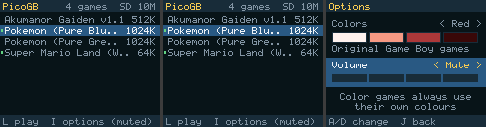
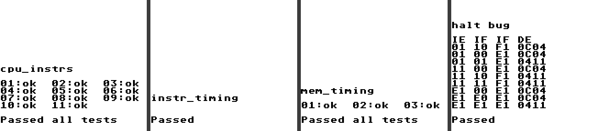

# PicoGB

A Game Boy and Game Boy Color emulator for the [Hack Club Sprig](https://sprig.hackclub.com/), a
handheld built around a Raspberry Pi Pico (RP2040). It runs on the Sprig with no extra hardware,
keeps its game library and saves on the SD card, and comes with a web page for adding games from
your PC.

It's written from scratch. It uses the Arduino core for the RP2040 and SdFat for the SD card, but
no emulator, graphics or game libraries. No Nintendo code is included: games start in the state
the boot ROM would leave them in.



## Contents

| Folder | What's in it |
|---|---|
| `firmware/PicoGB/` | The firmware |
| `firmware/PicoGB.uf2` | Ready to flash |
| `loader/` | The web loader (`index.html`) and command-line tool (`gbload.py`) |
| `host/` | The emulator core built for the PC, for running test ROMs |
| `bench/` | Probes for the Sprig's SD card and screen |

## Getting started

1. Hold **BOOTSEL** on the Pico while plugging it in, then drag `firmware/PicoGB.uf2` onto the
   `RPI-RP2` drive that appears.
2. Put a FAT32 microSD card in the Sprig's screen board. PicoGB keeps everything in a `PicoGB`
   folder and leaves the rest of the card alone.
3. Add games: either copy `.gb` / `.gbc` files into `PicoGB/games/` on the card, or double-click
   **`PicoGB Loader.bat`**, open the page in Chrome or Edge, click **Connect** and drop
   files onto it.
4. Pick a game on the Sprig.

The first time a game is launched it's copied from the card into the Pico's flash, which takes
about 8 seconds for a 1 MB game. Recently played games stay in flash and start instantly.

Use games you own: dumps of your own cartridges, or homebrew. `gameboy-games/` and ROM files
are in `.gitignore`, so they never end up in a repository.

## Controls

| Sprig | In a game | In the menu |
|---|---|---|
| W A S D | D-pad | W/S choose a game |
| L | A | Play |
| J | B | Back |
| I | Start | Options (default colours, volume) |
| K | Select | Hold 1.5 s: delete the game |
| I + K, held 0.5 s | Pause menu | |

The pause menu has save and load state (4 slots), volume, colours, screenshot, restart and quit.
Quitting saves a resume point, so the game picks up where you left it.

On the web loader your keyboard is the controller: arrows or WASD, X = A, Z = B, Enter = Start,
Backspace = Select. **Ctrl+Shift+4** unloads the running game.

## Colours

Games that support the Game Boy Color run in Color mode with their own colours. Original Game Boy
games have four shades and no colours of their own, so they get a tint: White by default (like a
Game Boy Pocket), or Blue, Red, Green or Yellow when the game's name says so. Each game remembers
the tint you pick in its pause menu.

## On the SD card

```
PicoGB/
  games/      your .gb and .gbc files
  saves/      battery saves (.sav, the usual format) and each game's colour choice
  states/     save states (.s1 to .s4) and resume points (.res)
  shots/      screenshots (.bmp)
  settings.txt, log.txt
```

## Command line

```
python loader/gbload.py list
python loader/gbload.py upload game.gb
python loader/gbload.py run 0
python loader/gbload.py shot screen.png
python loader/gbload.py perf          # speed and audio stats of the running game
python loader/gbload.py backup        # saves, states, screenshots, settings and log to the PC
```

Only one program can use the Sprig's USB port at a time, so close the web loader first.

## What's emulated

- The full CPU instruction set with correct timing, including memory access timing within
  instructions, the HALT bug, interrupts, timer, joypad and serial.
- Graphics: background, window, sprites, all their priority rules, and STAT/LYC interrupts. A line
  is drawn when it enters mode 3, which is what nearly every game expects.
- Game Boy Color: palettes, the second VRAM bank and tile attributes, banked work RAM, HDMA and
  double speed.
- All four sound channels, mixed to the Sprig's speaker. The audio buffer also keeps the emulator
  at the Game Boy's real speed.
- Cartridges: no mapper, MBC1, MBC2, MBC3 (with clock) and MBC5, with up to 32 KB of save RAM.

## Test results

| Test ROM | PC | Sprig |
|---|---|---|
| Blargg `cpu_instrs` | passed | passed |
| Blargg `instr_timing` | passed | passed |
| Blargg `mem_timing` | passed | passed |
| Blargg `halt_bug` | passed | passed |
| dmg-acid2 | pixel-exact | pixel-exact |
| cgb-acid2 | pixel-exact | |
| Double speed (`host/make_speedtest.py`) | CPU 2.00×, screen timing unchanged | |
| Battery saves (`host/make_savetest.py`) | | kept across relaunch and reboot |



## Speed

On the Sprig at 250 MHz a frame has to finish in 16.7 ms. Original Game Boy games take about
7 ms. Color games take 9 to 14 ms, and the heaviest scenes get right up to the limit, so Color mode
can feel slow now and then. The screen is fed at 25 MHz so it can show nearly every frame.

## Limits

- Games must fit in the roughly 1.5 MB of flash, which rules out the biggest Color games (2 MB and
  up, like Pokémon Crystal).
- Each Color frame is shown with the palettes it started with, so the few games that change colours
  partway down the screen look slightly off.
- Without an SD card, games uploaded over USB live in flash, but there are no save states.

## How it fits together

- **Core 0** runs the emulator, menus, storage, the USB protocol and sound.
- **Core 1** scales the 160×144 picture to the 160×128 screen by blending rows, rotates it for the
  portrait panel and sends it out in strips.
- The screen and the SD card share one SPI bus. A lock decides who has it, and the receive buffer
  is emptied after every screen transfer, because leftover bytes break the SD card's replies.
- Battery saves are written a block at a time while you play. Some games, Pokémon among them, use
  save RAM as scratch space, and rewriting the whole save each time froze the game.

## Building

Install [arduino-cli](https://arduino.github.io/arduino-cli/) and the
[arduino-pico](https://github.com/earlephilhower/arduino-pico) core (`rp2040:rp2040`), then:

```
arduino-cli compile -b rp2040:rp2040:rpipico:freq=250,opt=Optimize2 --output-dir firmware/build_gb firmware/PicoGB
arduino-cli upload  -b rp2040:rp2040:rpipico:freq=250,opt=Optimize2 -p COM10 --input-dir firmware/build_gb firmware/PicoGB
```

It uses the plain Pico board profile even on a Pico W, because the Pico W profile reserves RAM for
Wi-Fi that PicoGB doesn't use. `freq=250` is a mild overclock that almost every RP2040 handles; use
`freq=200` if yours doesn't.

## Testing on the PC

The emulator core has no hardware code, so it builds with any C++ compiler (MSYS2 g++ on Windows
works):

```
g++ -O2 -o host/gbtest host/gbtest.cpp firmware/PicoGB/gb.cpp firmware/PicoGB/gb_ppu.cpp firmware/PicoGB/gb_apu.cpp
host/gbtest cpu_instrs.gb 4000           # prints what a test ROM reports
host/gbtest cgb-acid2.gbc 120 shot.ppm   # saves the screen
```

The test ROMs aren't included. Blargg's are in
[retrio/gb-test-roms](https://github.com/retrio/gb-test-roms), and dmg-acid2 and cgb-acid2 are by
[Matt Currie](https://github.com/mattcurrie). `host/make_savetest.py` and `host/make_speedtest.py`
build two small test ROMs of our own.
